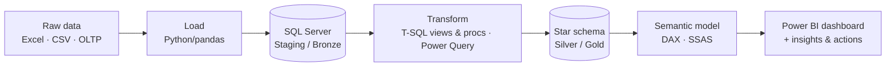

# Hi, I'm Đăng (Lê Hải Đăng)

**Aspiring Data Analyst** · Information Systems graduate, PTIT (2021–2026)

I turn raw Excel/CSV/OLTP data into clean models and dashboards that answer a specific business question: who to cross-sell to, where revenue leaks, why people leave.

  
  

---

## How I work with data

Every project starts from a business question and ends with concrete recommendations, not just charts.

---

## Featured projects

### [SOCOM Market Basket Analysis](https://github.com/Dangcodervn/socom-market-basket-analysis)
`Python` `SQL Server` `Medallion DWH` `Power BI` `DAX`
Built a Python ETL and a Bronze → Silver → Gold warehouse on SQL Server, then a 49-measure semantic model and 4-page dashboard for a cosmetics distributor. Found that cancelled orders made up 27.3% of all orders, and ranked cross-sell pairs by `lift × ln(order count)` so rare high-lift pairs do not crowd out reliable ones. *(synthetic data)*

### [Bank Customer Segmentation](https://github.com/Dangcodervn/bank-customer-segmentation)
`Power BI` `DAX` `Power Query`
Dashboard for a branch director targeting +20% quarterly revenue across 113K customers. Showed that Gold customers (3.2%) hold 78% of AUM, while Regular customers (80.6%) average only 0.23 interest-earning products, making them the main cross-sell target.

### [HR Contract & Workforce Analytics](https://github.com/Dangcodervn/hr-contract-workforce-analytics)
`Power BI` `DAX` `Power Query` `Python`
Analysed 2,586 employee contract records (2008–2019). Overall attrition was 39.6%, and 88.8% of leavers quit voluntarily. Identified managers with near-total team attrition that job-family mix could not explain.

### [Uniace Website Traffic & User Behavior](https://github.com/Dangcodervn/uniace-website-traffic-user-behavior-analysis)
`Python` `pandas` `Power BI` `DAX`
Cleaned 94K website event logs and built a 5-page dashboard on content, channels and timing. Data-skills content drove 55% of page views, and reminder emails were opened far more than clicked (28% click rate).

### [Freight Fleet Management](https://github.com/Dangcodervn/freight-fleet-management)
`SQL Server` `T-SQL`
Loaded and cleaned a logistics shipments dataset in SQL Server, then answered a set of ad-hoc business questions on fleet and shipment performance with T-SQL. <!-- TODO: add 1–2 key findings with numbers -->

### [AdventureWorks Data Warehouse & BI Solution](https://github.com/Dangcodervn/AdventureWorks-Data-Warehouse-BI-Solution)
`SQL Server` `T-SQL` `SSAS` `Power BI`
End-to-end Kimball pipeline: OLTP → Staging → star schema (2 fact tables, 6 conformed dimensions) → SSAS Tabular & Multidimensional → Power BI. T-SQL views and upsert stored procedures handle the transformation and incremental dimension refresh.

**More:** [Ecommerce Web Analytics (SQL)](https://github.com/Dangcodervn/ecommerce-web-analytics) · [RAG-based Legal Document Comparison](https://github.com/Dangcodervn/Rag-Based-Legal-Comparison)

---

## Tech stack

| Area | Tools |
|---|---|
| Query & storage | SQL (T-SQL, CTEs, window functions), SQL Server |
| Data prep & transform | Python (pandas), Power Query, T-SQL views & stored procedures |
| Modeling | Star schema, Medallion architecture, SSAS, DAX |
| Visualization | Power BI |
| Other | Git, Jupyter, Excel |

---

Open to Data Analyst / BI internship and junior roles.
